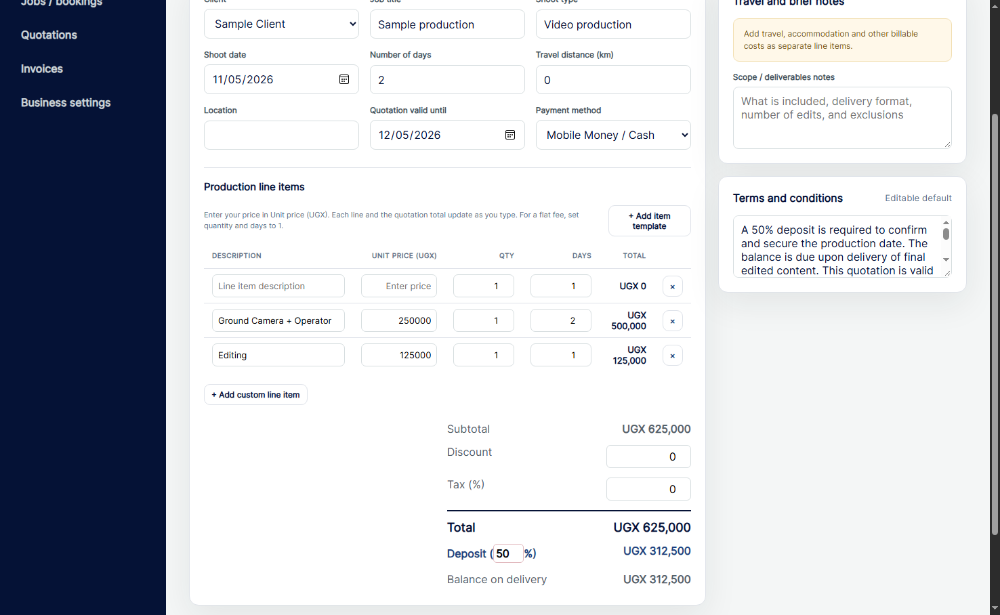

# Twisted Imagez Starter

**[Download for Windows (v1.0.3)](https://github.com/twistkan/twisted-imagez-starter/releases/download/v1.0.3/TwistedImagez.OneClick.exe)** · [Release notes and checksums](https://github.com/twistkan/twisted-imagez-starter/releases/tag/v1.0.3)

[](https://www.yotip.me/twistkan)

Local Windows booking, quotation and invoicing app for photography and filming.

## Screenshot


## Install or update on Windows

Download and run `TwistedImagez.OneClick.exe` on 64-bit Windows. Microsoft Edge WebView2 Runtime is required. The v1.0.2 launcher can also open a download with a suffix such as `_2` or ` (1)`.

To update, close any running Starter window and launch the new executable. Your existing Starter workspace is reused.

## First launch

1. Create a local login.
2. Enter your business name. Contact details, bank details and a logo are optional.
3. Open the workspace. You can edit your details and add, replace or remove your logo under **Business settings**. The Windows desktop shortcut uses your saved logo and switches back to the default icon when you remove it.

## Price a quotation

Enter a **Unit price (UGX)** on any line, whether you add it yourself or start from an item template. Templates start with blank prices. You can enter a whole amount with or without commas, such as `250,000`.

Each line calculates **unit price × quantity × days**. For a flat fee, set quantity and days to `1`. The subtotal, total, deposit and balance update as you type. The total includes any discount and tax you enter.



## Local data and backups

The one-click app stores its workspace under `%LOCALAPPDATA%\Twisted Imagez Starter\OneClickRuntime`. Use **Download backup** on the dashboard before moving PCs, and **Restore backup** to load that file on the other PC. Keep backups private because they contain your workspace records and settings.

## Build from source

Install the .NET 8 SDK, then run:

```powershell
powershell -ExecutionPolicy Bypass -File .\desktop\build-desktop.ps1
```

The main deliverable is `desktop/TwistedImagez.OneClick.exe`.
The build embeds an empty starter dataset from `sample-data/`.
Live clients, invoices, saved login details, printed documents and browser data
are excluded from this repository and from this build's starter dataset.
An existing user's runtime data is retained on later launches.
