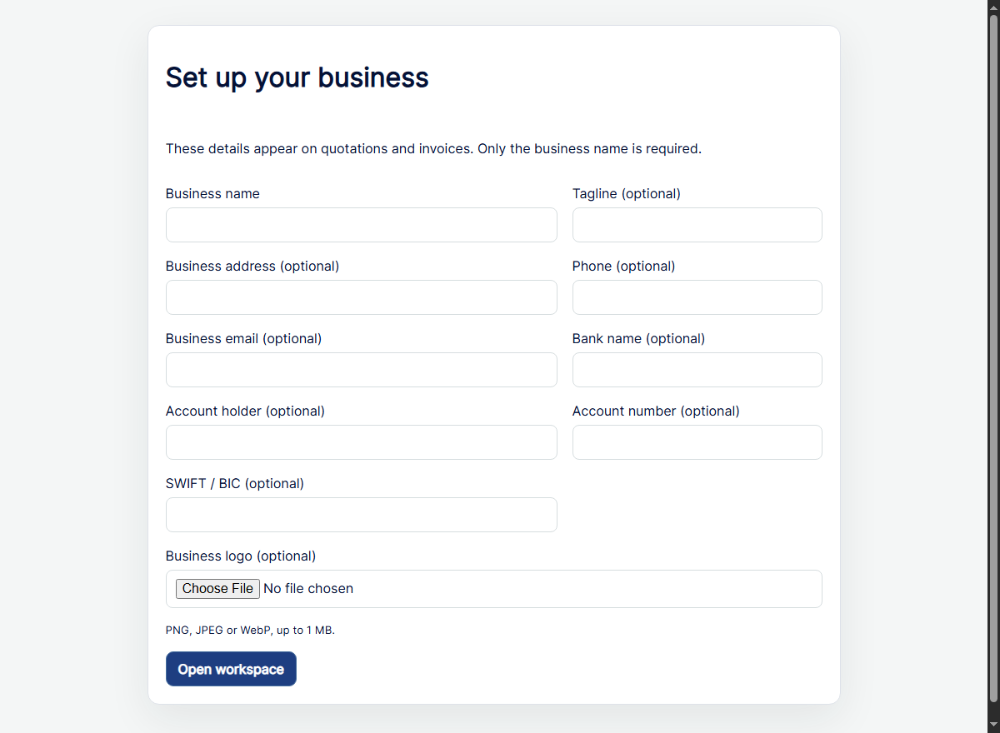

# Twisted Imagez Starter

**[Download for Windows](https://github.com/twistkan/twisted-imagez-starter/releases/download/v1.0.1/TwistedImagez.OneClick.exe)** · [Release notes and checksums](https://github.com/twistkan/twisted-imagez-starter/releases/tag/v1.0.1)

[](https://www.yotip.me/twistkan)

Local Windows booking, quotation and invoicing app for photography and filming.

## Screenshot



## First launch

Create your local login, then enter your business name. Contact details, bank details and a logo are optional. Edit them later under **Business settings**. Enter your own **Unit price (UGX)** on each quotation line, including template items. Line totals and the quotation total update as you type.

## Main Windows download

**`TwistedImagez.OneClick.exe`** is the main installer/launcher. Download it from
this repository's **Releases** page and double-click it. Keep this exact filename:
the application uses it to select its self-contained one-click mode.
No Python or Node.js installation is required. Microsoft Edge WebView2 Runtime
must be available.

On first launch it prepares its runtime under
`%LOCALAPPDATA%\Twisted Imagez Starter\OneClickRuntime`. Back up your data using the
app's JSON backup feature before moving PCs. This is a one-click application,
not an MSI setup wizard.

## Build from source

Install the .NET 8 SDK, then run:

```powershell
powershell -ExecutionPolicy Bypass -File .\desktop\build-desktop.ps1
```

The main deliverable is `desktop/TwistedImagez.OneClick.exe`.
The build embeds an empty starter dataset from `sample-data/`.
Live clients, invoices, saved login details, printed documents and browser data
are excluded from this repository and from this build's starter dataset.
An existing user's runtime data is retained on later launches.
